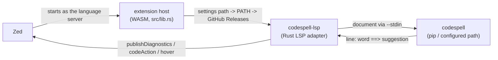

# Zed Codespell

A [Zed](https://zed.dev) extension that brings the
[codespell](https://github.com/codespell-project/codespell) spell checker to
the editor.

- **Diagnostics**: misspellings are flagged as warnings with suggested fixes
- **Quick fixes**: replace with a suggestion, ignore on this line or the next
  line, ignore for the session
- **Hover**: shows the suggested correction when the pointer is over a
  misspelling
- **Respects existing codespell configuration**: `.codespellrc` /
  `setup.cfg` / `pyproject.toml` (`[tool.codespell]`) are discovered from the
  project root automatically, matching command-line behavior for options such
  as `--ignore-words-list` and `--skip`

## Architecture: why the LSP is not implemented in Rust

`codespell` is a batch CLI and, as of v2.4.3, has **no LSP mode**: there are no
JSON-RPC or stdio-server options in `codespell --help`, and the project has no
LSP implementation in its source, open pull requests, or branches. It prints
`file:line: word ==> suggestion` lines. This repository therefore implements
only a **thin LSP adapter** (`codespell-lsp`) and delegates every spell-check
decision to the real `codespell` binary.



Following the same pattern as `codebook-zed` and the LemMinX extension, the
extension host resolves the `codespell-lsp` adapter automatically from:

1. a development binary `./codespell-lsp` in the extension directory
2. `codespell-lsp` on `PATH`
3. an automatic download from this repository's GitHub Releases

## Requirements

- **The `codespell` executable** (the Python tool that performs the checks,
  not `codespell-lsp`):

  ```bash
  pip install codespell        # or pipx / uvx / a system package
  ```

  If it is not on `PATH`, point `lsp.codespell-lsp.settings.codespell.path`
  at it. When it cannot be found, an error diagnostic explains how to
  install it.

## Installation

### Dev extension (while unpublished)

1. Build the adapter and make it available, or install it on `PATH`:

   ```bash
   nix develop    # development shell with Rust + codespell (flake)
   make test      # run tests
   make build-native && cp lsp/target/release/codespell-lsp .
   ```

2. In Zed, press `Cmd+Shift+P`, run `zed: install dev extension`, and select
   this directory.

### Published

Install "Codespell" from the Zed Extensions panel.

## Settings

The `codespell-lsp` adapter is the language-server process and is managed
automatically by the extension host (extension directory -> `PATH` -> GitHub
releases). Note that setting `lsp.codespell-lsp.binary.path` makes Zed launch
that executable as the language server directly, bypassing this extension
(Zed's `get_language_server_binary` honors `binary.path` first). Only real
LSP servers belong there; the `codespell` CLI must be configured through the
`codespell` settings block instead:

```jsonc
{
  "lsp": {
    "codespell-lsp": {
      "settings": {
        "codespell": {
          "path": "/nix/store/.../codespell-2.4.3/bin/codespell", // optional; default: PATH lookup
          "args": [],                            // extra codespell CLI arguments
          "run": "onSave",                      // "onSave" | "onType" (default: onSave)
          "ignoreWords": [],                    // -L / --ignore-words-list
          "ignoreWordsFile": null,              // -I / --ignore-words
          "skip": [],                           // -S / --skip globs
          "config": null,                       // --config path
          "dictionary": [],                     // -D / --dictionary
          "builtin": null,                      // --builtin (default: clear,rare)
          "ignoreRegex": null,                  // --ignore-regex
          "ignoreSic": false,                   // --ignore-sic
          "uriIgnoreWords": []                  // --uri-ignore-words-list
        }
      }
    }
  }
}
```

This matches the keys of the companion VS Code extension. The adapter resolves
the `codespell` executable from `codespell.path`, then `PATH`; `binary.env`
environment overrides are inherited by the `codespell` process.

### codespell configuration files

The adapter launches `codespell` with the project root as its working
directory, so `.codespellrc` / `setup.cfg` / `pyproject.toml` settings apply
exactly as they do on the command line. `skip` is additionally mirrored
server-side so the editor does not check skipped files (stdin checks carry no
filename that `codespell` could match).

## Supported languages

See the `languages` list in `extension.toml` (40 languages including
Markdown, Plain Text, Rust, Python, TypeScript, Go, and LaTeX). No tree-sitter
grammar is required: like `codebook` and `typos`, the extension does not
grammar-tokenize, and word-level tokenization is performed by `codespell`
itself.

## Development

```bash
nix develop          # dev shell via rust-overlay (wasm32-wasip1/2 targets included)
make check           # fmt + clippy + test
make build           # build the extension host as a WASM component
make build-native    # build the codespell-lsp adapter natively
make dev             # instructions for installing the dev extension
```

## License

Apache-2.0, see [LICENSE](LICENSE). The codespell software and dictionary data
have their own licenses (GPL-2.0 and CC-BY-SA-3.0 respectively); see
[NOTICE](NOTICE). This repository does not redistribute `codespell` or its
dictionary data.
